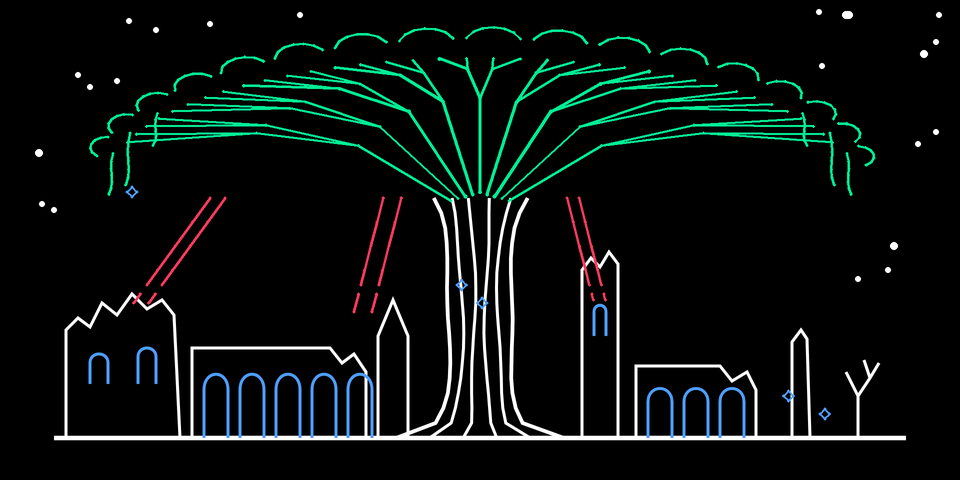
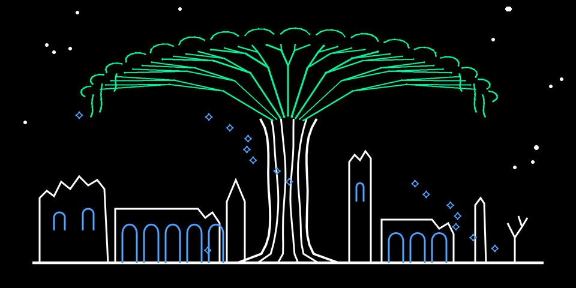
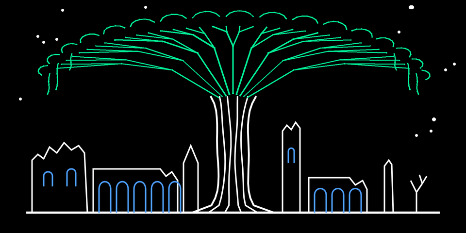
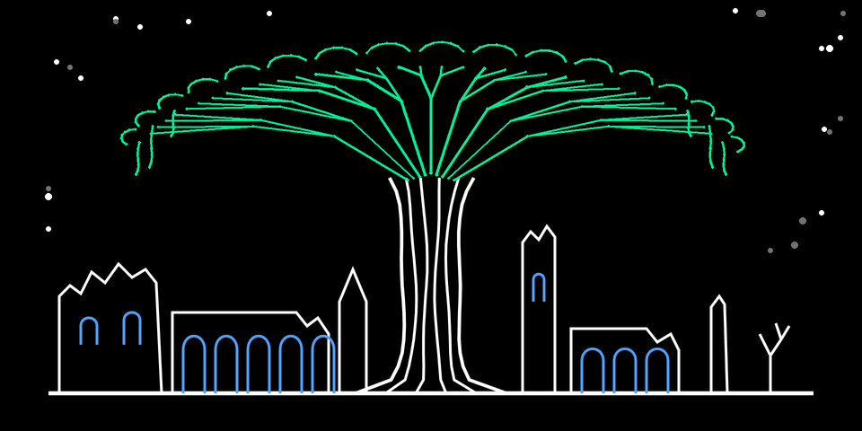
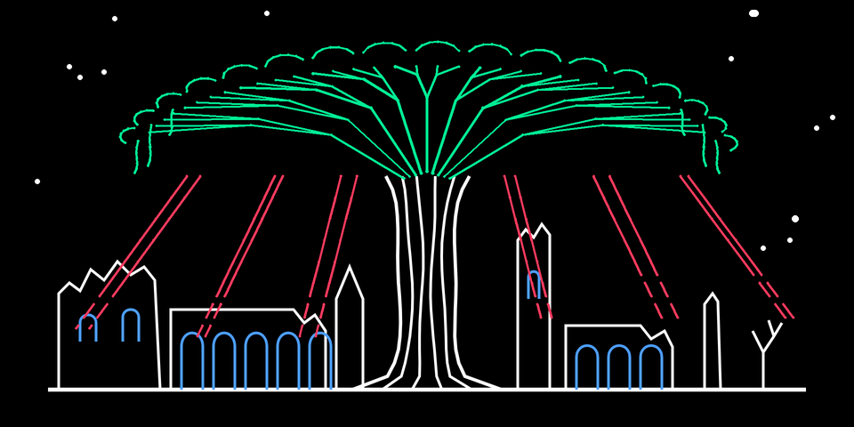
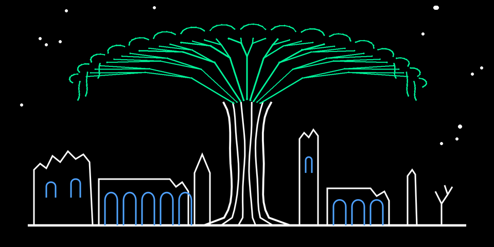
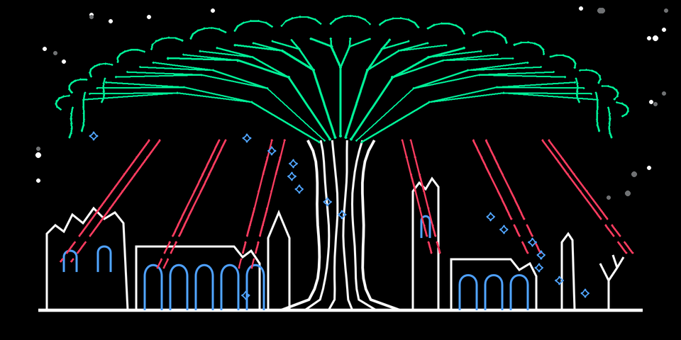

# Project_Erdtree
A custom Elden Ring engine for the OP-1

**erdtree** is an Elden Ring-inspired synth engine for the original OP-1. It plays like a small orchestra under the
Erdtree, and each encoder brings in its own section.

## Download

**[Download erdtree.zip](https://github.com/SammiBabe666/Project_Erdtree/raw/main/erdtree.zip)**: nothing to build.
Unzip it, pick the folder for the firmware mod your OP-1 runs, and follow `INSTALL.txt`.

| In the zip | For |
|---|---|
| `Opus 2/erdtree.opmod` | [Opus 2](https://github.com/LizardMan245/opus) (core 2.6 or later): copy it into the OP-1's `mods` folder in disk mode and restart. |
| `Hundekraft Workshop/erdtree.knl` | The [Hundekraft Workshop](https://hundekraft.github.io/op1-workshop/) 3.0.x: add it under "Your plugins" and update the OP-1. |
| `presets/synth/erdtree/` | Eight sounds for either one: copy the `erdtree` folder into the OP-1 disk's `synth/` folder. |
| `INSTALL.txt` | The steps for each, the presets and the encoders. |

Both builds play the same sound, draw the same screen and load the same presets. The Opus 2 build has not run on an
OP-1 yet: keep Opus's developer mode on while you try it.

**Demo video:** [media/opus/erdtree_opus_demo.mp4](media/opus/erdtree_opus_demo.mp4). It is 22 seconds, with sound.
Each section comes in on its encoder while the screen follows: strings, then brass, choir and space.

## What the encoders do

Choose erdtree in synth mode (shift + T1, then `erdtree` in the engine list). On its T1 page, each encoder brings in
one section of the orchestra and animates its own part of the screen.

| Encoder | Section | What you hear | What you see |
|---|---|---|---|
| **Blue** | Choir | Spectral voices: harmonics 1 to 6 of a slightly sharp tone, with a slow breath and a shimmer on the top harmonics. | Leaves fall from the crown, none at zero and up to 16 at full. |
| **Green** | Strings | Two detuned violins and celli an octave down. The bow swells in and opens the tone, and vibrato arrives once the note settles. | The crown grows from 86 % to full size and sways. |
| **White** | Space | Distance: wider section detune, a darker tone, a slower bloom on the strings and a deeper choir breath. | Stars multiply, from 14 to 36, and twinkle more the further out it goes. |
| **Orange** | Brass | The Brassophone horn. More brass is louder and brighter, and each note gets a short lip scoop. Its tone follows the T2 envelope. | Shafts of light break through under the crown, up to six, longer with more brass. |

- Blue, green and orange are levels. They use a squared curve, so the first part of each turn fades a section in
  gently. With all three at zero there is silence.
- White is not a reverb. For the cathedral sound, put a reverb on the synth's effect slot.
- The rest of the controls are the OS's own: the T2 envelope, the T4 LFO, and the effect on T3. No shift or FN
  layer is taken.
- A new sound starts at the "first grace" settings: blue 10000, green 26000, white 12000, orange 16000. That is
  mostly strings, some brass, a touch of choir and a little space.

| Blue: choir | Green: strings |
|---|---|
|  |  |
| **White: space** | **Orange: brass** |
|  |  |
| **All at zero** | **All at full** |
|  |  |

In each screenshot, one encoder is at full and the others are at zero. The screenshots and the video come from the
Opus build's own page code, run on a PC (`opus/test/opus_video.c` and `opus_video.py`). The colours are the OP-1's
stock encoder colours: under an Opus colour theme, the crown, leaves, arcade windows and light shafts take that
theme's colours.

## Layout

| Folder | What |
|---|---|
| `source/` | The engine's C source, generated tables and art, preset generator, host test harness |
| `erdtree.zip` | The download: both builds, the presets, `INSTALL.txt` |
| `release/` | The built `erdtree.knl` (v0.5, Hundekraft Workshop 3.0.x) with its SHA-256, the preset pack, the changelog; `older/` has v0.4; `opus/` has `erdtree.opmod` for Opus 2 |
| `opus/` | The Opus 2 port: the plugin folder `sammi.erdtree/`, its art generator and PC tests ([opus/README.md](opus/README.md)) |
| `media/` | Demo audio, preset tour, demo videos and the screen preview; `opus/` has the Opus build's screenshots and demo video |
| `social/` | Reddit and Discord announcement drafts |

`source/erdtree.svg` is the output of `python3 source/gen_svg.py`.
