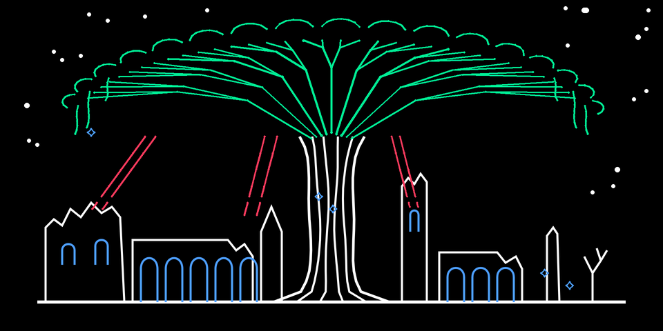
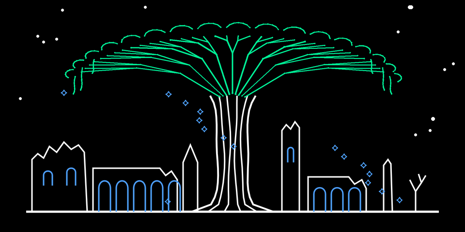
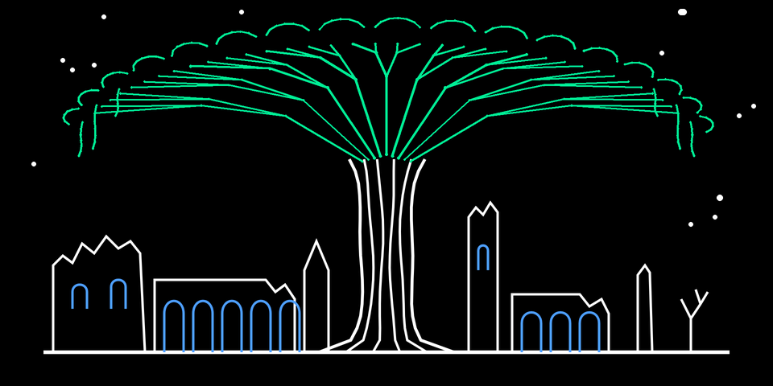
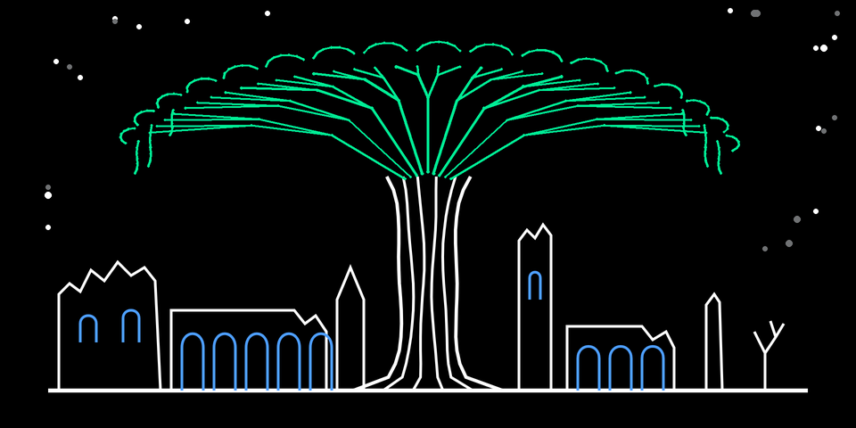
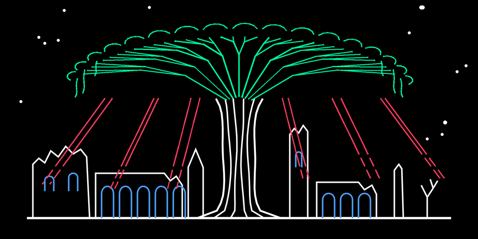
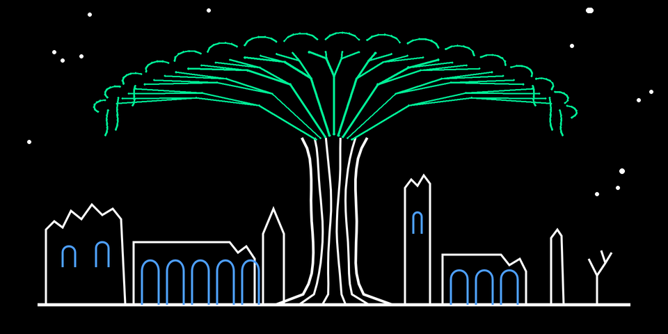
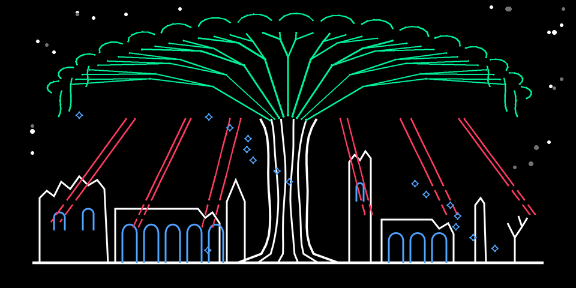

# Project_Erdtree
A custom Elden Ring engine for the OP-1

**erdtree** is an Elden Ring-inspired synth engine for the original OP-1. It plays like a small orchestra under the
Erdtree, and each encoder brings in its own section.

## Download: pick your firmware

erdtree runs under two firmware mods for the OP-1, and each has **its own plugin and its own presets**. They are not
interchangeable: use the zip for the mod your OP-1 runs.

| Your OP-1 runs | Download | Plugin | Presets |
|---|---|---|---|
| [Opus 2](https://github.com/LizardMan245/opus) (core 2.8 or later) | **[erdtree-opus.zip](https://github.com/SammiBabe666/Project_Erdtree/raw/main/downloads/erdtree-opus.zip)** | `erdtree.opmod` 0.6.1 | the dark-fantasy collection: eight sounds made for Opus (coming: see below) |
| The [Hundekraft Workshop](https://hundekraft.github.io/op1-workshop/) 3.0.x | **[erdtree-hundekraft.zip](https://github.com/SammiBabe666/Project_Erdtree/raw/main/downloads/erdtree-hundekraft.zip)** | `erdtree.knl` v0.5 | first grace, golden order and six more |

Unzip it and follow its `INSTALL.txt`.

- **Opus:** 0.6.0 loaded but stayed silent on an OP-1, most likely because Opus's CPU guard switched it off. 0.6.1 is
  much lighter and has not been confirmed on a device yet: keep developer mode on while you try it. The eight Opus
  presets are designed and measured, but their files wait on one detail of Opus's preset format. Until then, the
  values are in [the preset guide](docs/preset-guide.md) to set up by hand.
- **Hundekraft presets do not load on Opus**, and Opus presets do not load on the Workshop.

## Platforms

| | Hundekraft Workshop | Opus 2 |
|---|---|---|
| Everything for it | [platforms/hundekraft/](platforms/hundekraft/) | [platforms/opus/](platforms/opus/) |
| Read me (features, build, tests) | [README](platforms/hundekraft/README.md) | [README](platforms/opus/README.md) |
| Install steps | [INSTALL.txt](platforms/hundekraft/INSTALL.txt) | [INSTALL.txt](platforms/opus/INSTALL.txt) |
| Presets | [presets/](platforms/hundekraft/presets/) | [presets/](platforms/opus/presets/), one folder each |
| Built plugin | [build/erdtree.knl](platforms/hundekraft/build/) | [build/erdtree.opmod](platforms/opus/build/) |
| Build it | `scripts/build-platform/build-hundekraft.sh` | `scripts/build-platform/build-opus.sh` |

Both play the same sound (checked sample by sample on a PC) and draw the same screen. What differs between them:
[docs/platform-compatibility.md](docs/platform-compatibility.md).

**Demo video (Opus build):** [erdtree_opus_demo.mp4](platforms/opus/assets/erdtree_opus_demo.mp4), 22 seconds with
sound. **The eight Opus presets, rendered on a PC:** [tour.mp3](platforms/opus/assets/presets/tour.mp3).

## What the encoders do

Choose erdtree in synth mode (shift + T1, then `erdtree` in the engine list). On its T1 page, each encoder brings in
one section of the orchestra and animates its own part of the screen.

| Encoder | Section | What you hear | What you see |
|---|---|---|---|
| **Blue** | Choir | Spectral voices: harmonics 1 to 6 of a slightly sharp tone, with a slow breath and a shimmer on the top harmonics. | Leaves fall from the crown, none at zero and up to 16 at full. |
| **Green** | Strings | Two detuned violins and celli an octave down. The bow swells in and opens the tone, and vibrato arrives once the note settles. | The crown grows from 86 % to full size and sways. |
| **White** | Space | Distance: wider section detune, a darker tone, a slower bloom on the strings and a deeper choir breath. | Stars multiply, from 14 to 36, and twinkle more the further out it goes. |
| **Orange** | Brass | The Brassophone horn. More brass is louder and brighter, and each note gets a short lip scoop. Its tone follows the T2 envelope. | Shafts of light break through under the crown, up to six, longer with more brass. |

- Blue, green and orange are levels. They use a squared curve, so the first part of each turn fades a section in
  gently. With all three at zero there is silence.
- White is not a reverb. For the cathedral sound, put a reverb on the synth's effect slot.
- The rest of the controls are the OS's own: the T2 envelope, the T4 LFO, and the effect on T3. No shift or FN
  layer is taken.
- A new sound starts at blue 10000, green 26000, white 12000, orange 16000: mostly strings, some brass, a touch of
  choir and a little space.

| Blue: choir | Green: strings |
|---|---|
|  |  |
| **White: space** | **Orange: brass** |
|  |  |
| **All at zero** | **All at full** |
|  |  |

In each screenshot, one encoder is at full and the others are at zero. They come from the Opus build's page code, run
on a PC. Under an Opus colour theme, the crown, leaves, arcade windows and light shafts take that theme's colours.

## What's here

| Folder | What |
|---|---|
| `downloads/` | The two zips users install from |
| `platforms/hundekraft/` | The Hundekraft Workshop build: source, presets, tests, assets, the built `.knl` |
| `platforms/opus/` | The Opus 2 build: source, presets, tests, assets, the built `.opmod` |
| `shared/` | Platform-independent notes only: how the engine makes its sound, what each preset collection is meant to be |
| `scripts/` | `validate-presets/` checks every preset; `build-platform/` builds each platform and makes the zips |
| `docs/` | [Overview](docs/overview.md), [platforms](docs/platform-compatibility.md), [presets](docs/preset-guide.md), [development](docs/development.md), [the Opus port report](docs/port-report.md), [changelog](docs/changelog.md) |

## Licence

GPL-3.0-or-later with the OP-1 firmware permission (`LICENSE` and `NOTICE`, also in both zips). The brass voice comes
from Brassophone by nick (nvmsocool). Elden Ring and the Erdtree belong to FromSoftware and Bandai Namco: this is an
unofficial fan tribute.
